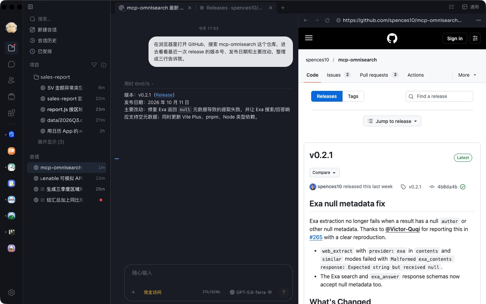
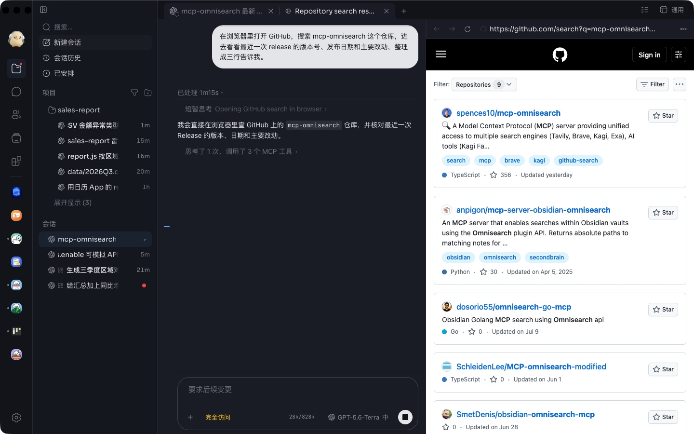
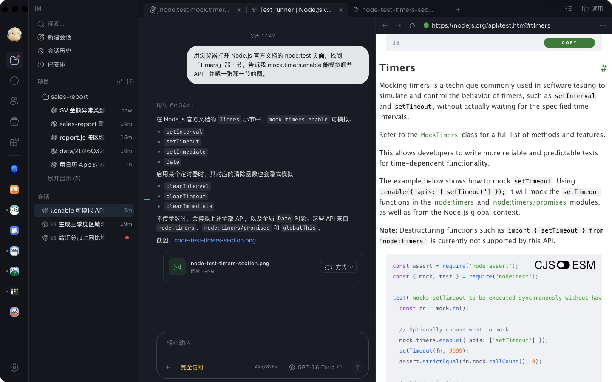

# Browser Use

让 Agent 在自己会话的咕咕浏览器页签里浏览、点击、填写和截图。复用该页签的浏览器配置和登录，不启动独立浏览器。

安装后点击 App，打开咕咕提供的配置与状态页：设置新页签的起始网址、控制 Agent 使用权限、查看当前网页，并停止或恢复 Agent 的操作。浏览器配置和导入登录仍在咕咕「设置 → 浏览器」。

人点进正在操作的网页或按「停止」后，Agent 会暂停；只有人点「让 Agent 继续」才会恢复。卸载或停用此 App 后，Agent 无法继续调用它的工具，手动浏览网页照常可用。

本 App 需要支持 App API 5 的咕咕。包中只有声明与说明，网页操作由咕咕宿主的原生桥执行，工具来自 Apache-2.0 授权的 Playwright MCP。

源码：本仓 `sources/browser-use/`，安装包目录 `app/`。
