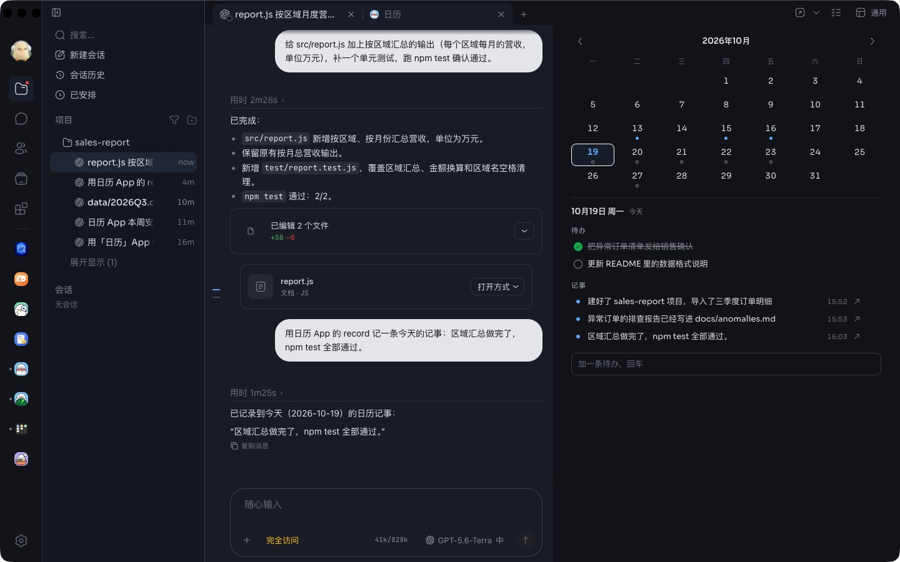
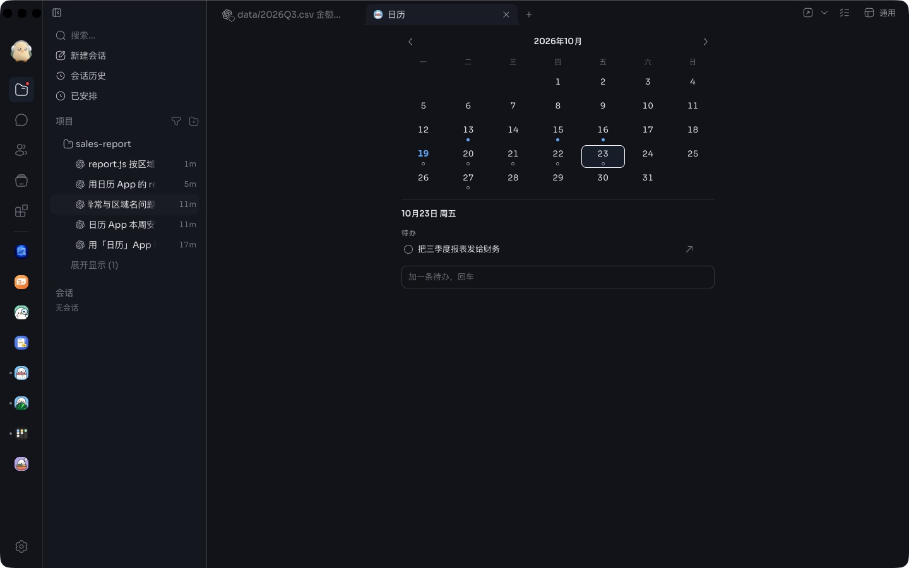

# 日历

任务页右侧栏里的日历。上面是一个月，每一天有一个小记号：还有没勾掉的待办是一个圈，待办都勾完了是一个实心点，只有记事是另一种颜色的点。下面是选中那天的待办和记事。

## 页面上

- 点某一天看那天；点月份回到今天；左右箭头翻月。
- 在下面的输入框里写一条，回车，就加在选中的那一天，是一条待办。
- 点待办勾掉或取消；点右边的 × 删掉。
- agent 记下的那一条，右边多一个箭头，点它回到记下它的那个任务。

## agent 怎么用

`record({ kind, title, detail?, tags?, date?, time? })`：

- `kind`：`todo` 是打算做的事（能勾），`memory` 是已经发生的事；
- `title`：一行，用人的原话；
- `date`：`YYYY-MM-DD`，要是真有的一天，不写就是今天；`time`：`HH:MM`，记事不写就是现在；
- 同一天、同一类、同一行字只记一次，重试不会多出一条。

勾掉和删掉只在页面上能做，agent 看不到这两个工具。

## 数据

都存在这个 App 自己的数据文件夹里（`journal.json`），只有它自己的程序写：页面上的改动和 agent 的 `record` 走的是同一个程序，谁也不会把谁的覆盖掉。卸载就删掉。agent 记下一条以后，开着的页面在 3 秒内显示出来；页面不在屏幕上时不去读。

## 较早的咕咕

「回到记下它的任务」那个箭头，要咕咕能告诉程序是哪个任务调的它，并且有 `showSession`。没有的咕咕上，记事照常记，只是那个箭头不出现。

## 需要的能力

给 agent 提供工具（`agents:tools`）。
