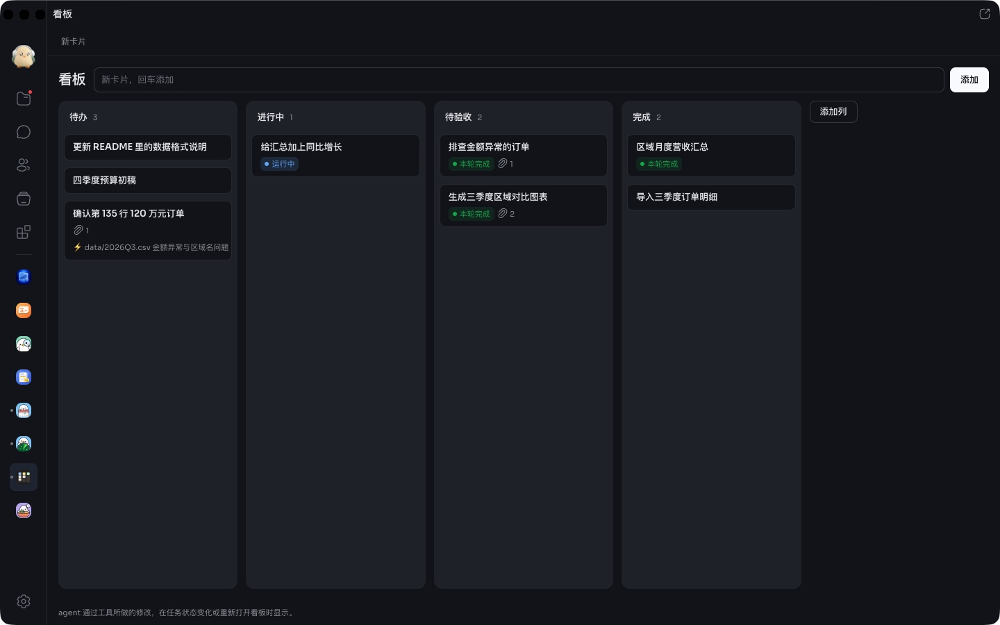
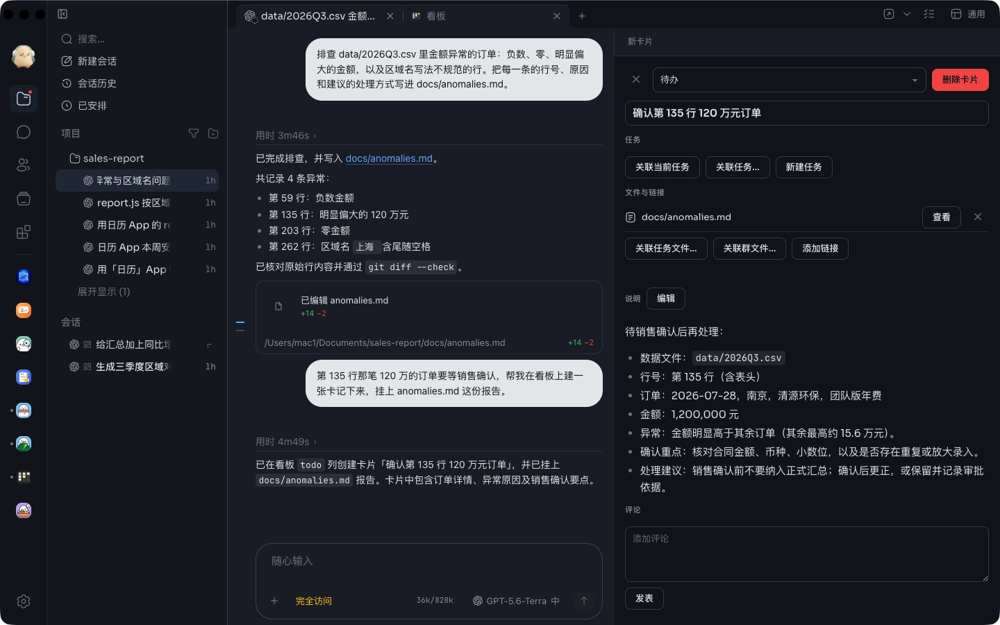
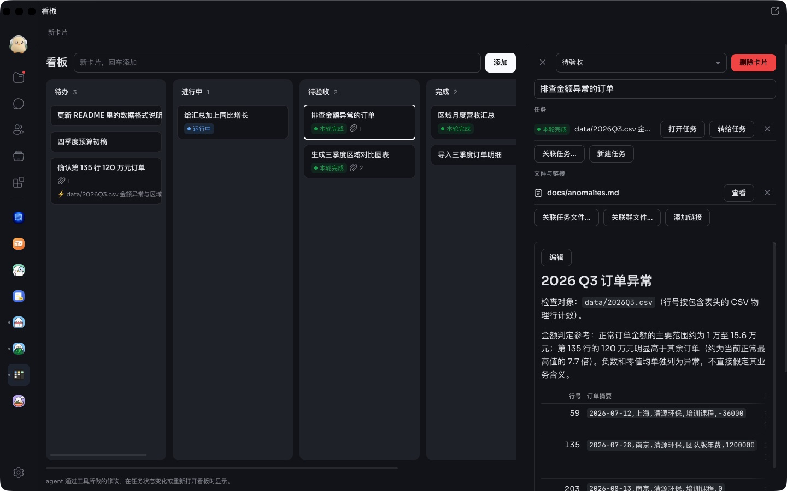

# 看板

本机任务看板。数据只保存在这台电脑上。

## 入口

- 左侧栏：安装后固定在左侧栏，打开为整页。
- 任务页：标签栏「+」菜单。在任务内新建卡片时，可直接关联该任务。
- 群、私聊、话题：右栏「⋯」菜单。

各入口显示同一块看板，任一处的修改会同步到其他入口。

## 功能

- **关联任务**：卡片可关联本机任务，并显示任务状态（运行中、待批准、待回复、本轮完成、已停止、出错）；待处理的卡片数显示在标签角标上。支持打开任务、转给任务（将卡片内容填入任务输入框，由你决定是否发送）和新建任务。
- **文件与链接**：卡片可关联任务文件、群文件、链接、PR 和群消息。Markdown、文本、代码、JSON 可在卡片内查看和编辑，图片和视频可在卡片内查看；其他类型用对应的 App 打开。
- **agent 工具**：`list`、`get`、`create`、`claim`、`move`、`comment`、`link`，以及 skill `kanban`。agent 通过工具所做的修改，在任务状态变化或重新打开看板时显示。

## 数据

保存在本机 App 数据目录（`board.json`），同一台电脑上的不同账号共用。卸载 App 时一并删除。不上传，不跨设备同步。

## 权限

| 权限 | 用途 |
|---|---|
| 读取本机全部 agent 的状态（`agents:read:all`） | 在卡片上显示关联任务的标题和状态，不读取对话内容 |
| 启动 agent（`agents:control`） | 新建任务；仅在点击时启动，且只管理由看板启动的任务 |
| 读取、写入文件（`files:read` / `files:write`） | 在卡片内查看和编辑任务文件与群文件 |
| 为 agent 提供工具（`agents:tools`） | agent 的看板工具；看板数据也只经此程序写入 |

不访问网络。
