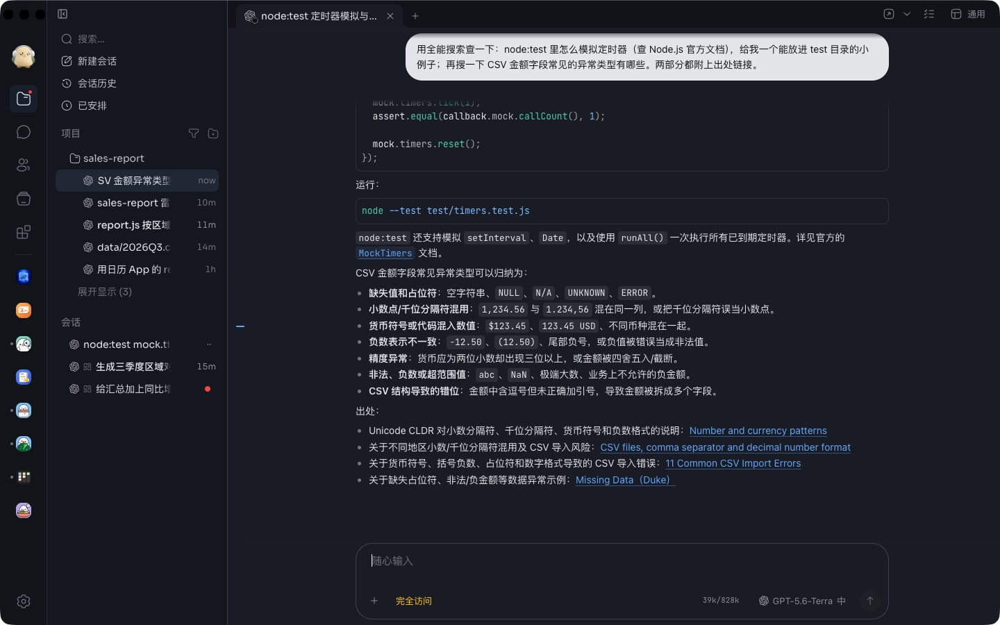
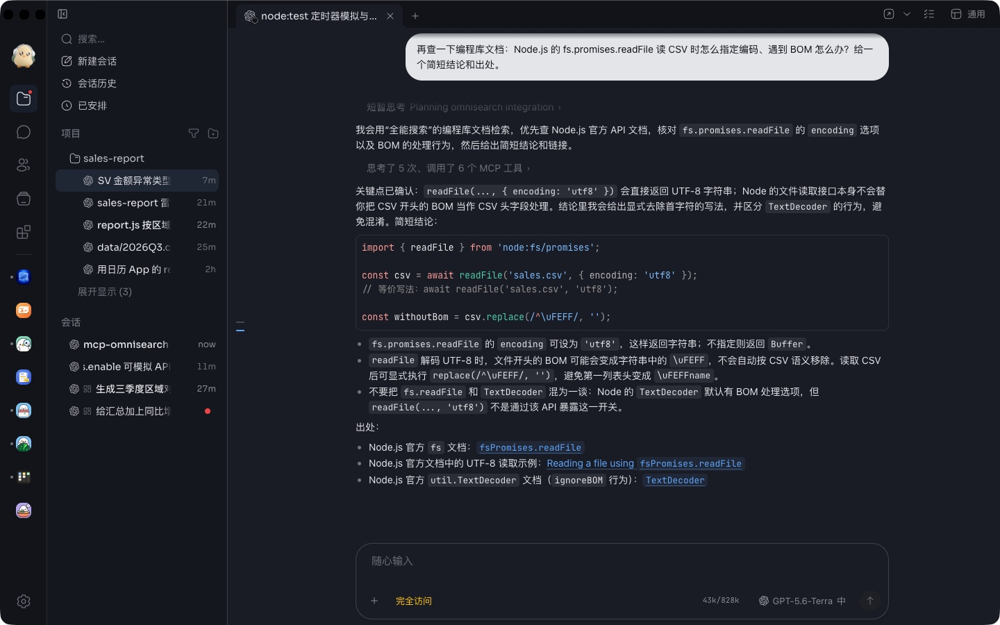
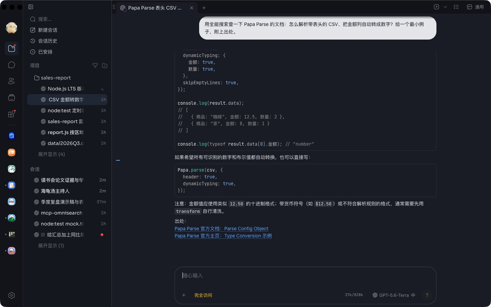

# 全能搜索

给这台电脑上的 agent 用的搜索工具：网页搜索、读网页、查编程库文档、带出处的回答、搜 GitHub。
在这里选每一项用哪家服务、填上那家的 API 密钥，agent 就能用；没填密钥的那几项，agent 一个都看不到。

- 服务：Firecrawl、Context7、Tavily、Exa、Brave Search、Kagi、Linkup、GitHub。密钥只存在这台电脑上
  （本 App 的数据夹里的 `settings.json`），agent 也可以直接改这个文件，改了马上生效。
- 搜索程序来自开源项目 [mcp-omnisearch](https://github.com/spences10/mcp-omnisearch)（MIT，Scott Spence），
  咕咕在它上面加了 Firecrawl 网页搜索和 Context7 编程库文档。许可证见 `server/LICENSE`。

---

Search tools for the agents on this computer: web search, reading pages, library docs, cited answers, GitHub search.
Pick a service for each and paste its API key; what has no key, agents do not see. Keys stay on this computer, in this
App's `settings.json`. The search program is [mcp-omnisearch](https://github.com/spences10/mcp-omnisearch) (MIT, Scott
Spence) with Firecrawl web search and Context7 library docs added; its license is in `server/LICENSE`.
