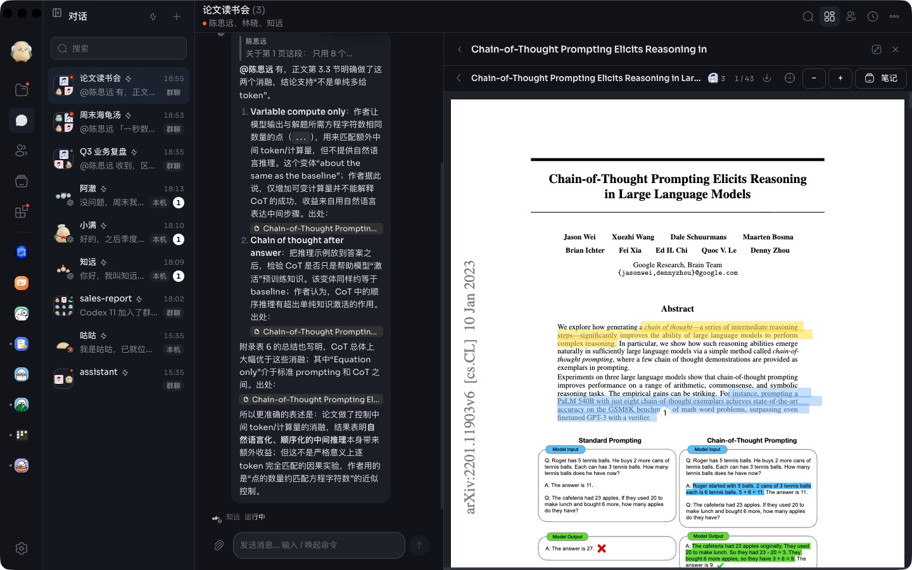
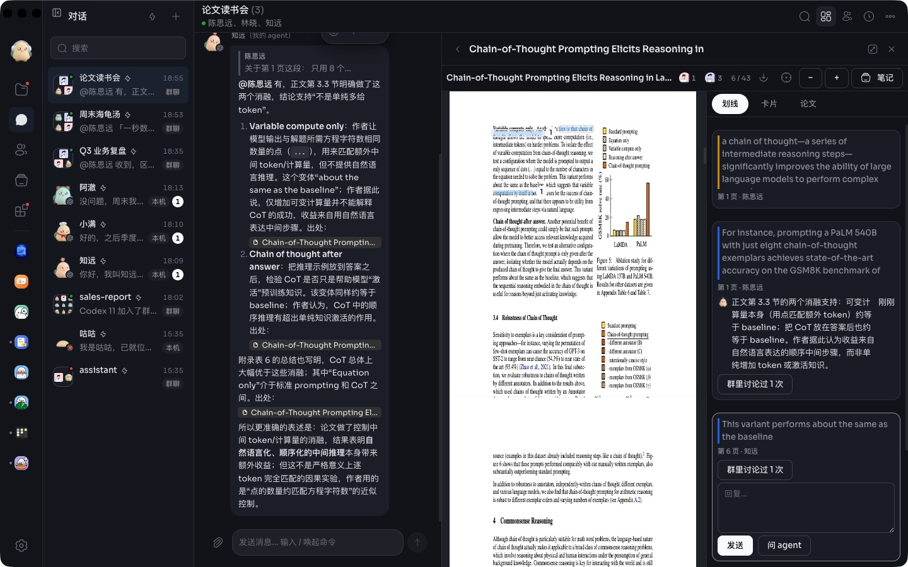
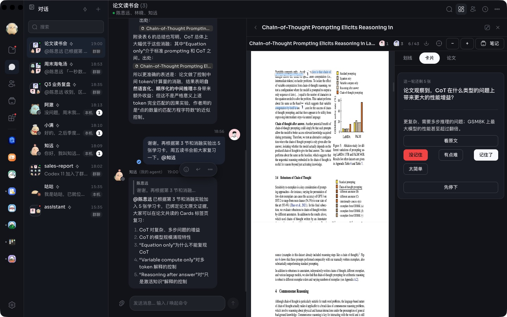

# 论文共读

一个群就是一个读书会。论文的 PDF 放在群文件夹里，大家的划线、讨论和学习卡就记在它旁边的 `<论文名>.paper.json` 里。人和 agent 都用自己的身份参与，引用一律是胶囊，点一下就回到原文那一处。

- **读**：点开群文件夹里的 PDF。选中文字可以划线，框选可以圈出图表或公式；每处划线都有自己的讨论串。顶栏显示谁在读第几页，点头像就跟着他翻页。
- **群里说过什么**：每处划线旁边显示它在群里被讨论过几次，展开就是那几条消息，点一下跳到群里。
- **问**：选一段，点「问 agent」，这一段会作为胶囊放进群的输入框，@ 群里的 agent 再发出去。agent 读全文、找证据，回答里的每一处出处都是胶囊。
- **学**：agent 出的学习卡都挂着原文出处。每个人按间隔重复复习，错题、掌握度都记下来，桌面和手机通用。
- **导入**：在群右栏的书架里贴 arXiv 编号、DOI 或链接，或者上传 PDF。

给 agent 的工具：`read`、`notes`、`evidence`、`cite`、`comment`、`add_cards`、`import_paper`。读书会里的做法写在 skill `paper-club` 里。

PDF 用 [PDF.js](https://github.com/mozilla/pdf.js)（Apache-2.0）渲染，打包在 `vendor/pdfjs/` 里，许可证在同一目录。
