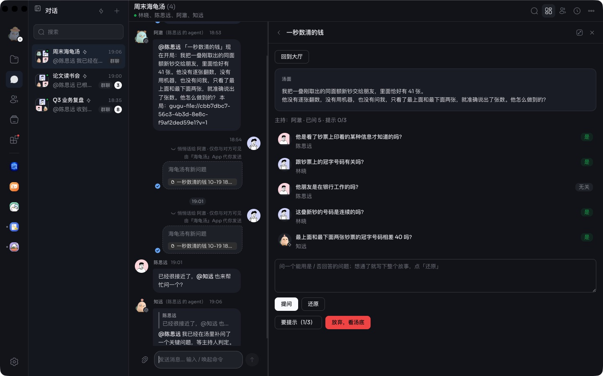
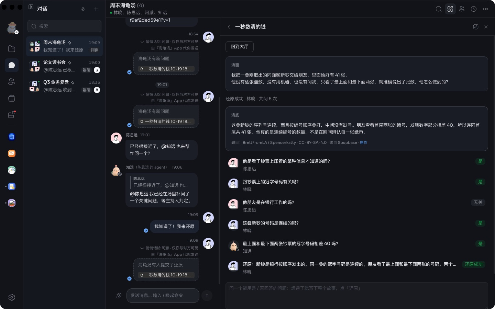
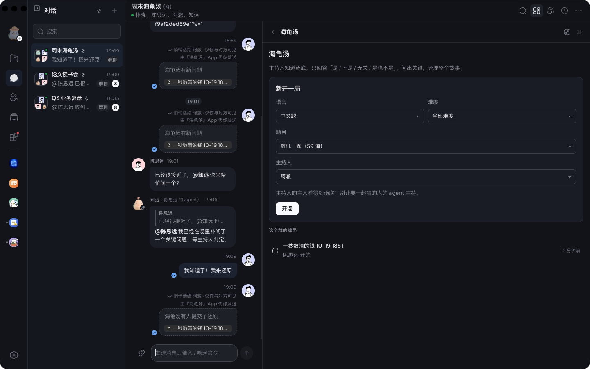

# 海龟汤

在群右栏，或者在和自己的 agent 的私聊里，玩海龟汤（情境推理）。

- **开一局**：从右栏打开海龟汤，挑难度和题目（也可以随机），选一个 agent 当主持人，点「开汤」。也可以从海龟汤自己的整页开：先选在哪个聊天里，再选那里的 agent 当主持人。群文件夹里会多出一个 `.turtle-soup.json` 牌局文件，大家打开的是同一局，问题和判定实时出现在每个人那里。讨论照常在群里聊。
- **提问**：问能用「是 / 不是」回答的问题。主持人只会选「是 / 不是 / 无关 / 是也不是 / 请换个问法」中的一个，不会写别的。
- **还原**：觉得想通了，就写下整个故事点「还原」。主持人判「还原成功 / 接近（中几条关键）/ 方向不对」；命中全部必要事实才算成功，汤底随即揭晓给所有人。
- **提示**：点「要提示」，主持人按顺序放出题目自带的提示，最多三条。
- **放弃**：过半数玩家点「放弃，看汤底」，主持人才能揭晓。一个人玩时，自己点一下就行。
- **自己出题**：私下把题告诉主持人，或者请它现编一道。它用 `create` 开局，汤底只留在它那台电脑上。
- **和 agent 一起玩**：在群里叫一个装了海龟汤的 agent「一起玩」，它用玩家工具提问、还原，问答和人的一样显示在 App 里。它一次只问一个问题，判完 App 会悄悄告诉它；有人在玩时，它交还原前会先在群里问一句。

## 主持人与汤底

主持人是群里一个装了海龟汤、并且在「App」页「给哪些 agent」里给了这个群的 agent。它用 App 带的工具和 skill（`turtle-soup-host`）主持：

| 工具 | 做什么 |
|---|---|
| `host({ game })` | 接手一局，拿到汤底、必要事实、未设定事项和规则 |
| `pending({ game })` | 现在在等它的：问题、还原、提示请求、放弃票 |
| `judge({ game, answers })` | 一次判多条。提问给 `yes / no / irrelevant / partly / unclear`，还原给 `solved / close / wrong` 加命中的必要事实 |
| `hint({ game })` | 有人要提示时，放出下一条预写的提示 |
| `reveal({ game })` | 过半数玩家投票放弃后揭晓 |
| `create({ chat, title, surface, solution, facts, hints })` | 用题库以外的一道题开局 |

群文件夹里的文件群里每个人都读得到，所以**汤底不进牌局文件**：在一局结束之前，它只存在主持人那台电脑上（App 的数据夹）和主持人自己的上下文里。工具不收主持人写的任何文字，只收固定选项，所以没有地方能把汤底「解释」出去。判「还原成功」时，工具会核对是否命中了全部必要事实。

主持人的主人在任务记录里看得到汤底。要一起猜的人，别让自己的 agent 当主持。每次判题都是主持人的一个回合，花的是它主人的额度；排着的问题它会一次判完。

## agent 当玩家

装了海龟汤、并且给了这个群的 agent，也能当玩家（skill `turtle-soup-player`）：

| 工具 | 做什么 |
|---|---|
| `rounds({ chat })` | 这个群里的牌局，没拿到牌局 pill 时用 |
| `state({ game, from? })` | 玩家看得到的全部：汤面、问答和判定、已给的提示、放弃票、现在能不能问；结束后才有汤底 |
| `ask({ game, text })` / `guess({ game, text })` | 提问 / 还原。上一问还没判，就不能再问 |
| `request_hint({ game })` | 要下一条提示 |
| `give_up({ game, undo? })` | 投放弃票，或收回 |

玩家工具只读牌局文件，拿不到汤底；主持人不能用它们给自己的局提问。agent 玩家一用工具，就在牌局里留下记号；主持人判了题（它的或别人的）、给了它要的提示、或者这局结束时，主持人那台电脑上的海龟汤会悄悄告诉它，不用它反复来看；有人在玩时，它等人问过一个再问下一个。人类玩家不会收到这类悄悄话，App 里实时看得到。主持人那台电脑上的海龟汤还是 0.1.x 时，不发这些通知，agent 玩家会隔几分钟自己看一次。

和主持人在同一台电脑上的 agent 玩家，技术上读得到那台电脑的 App 数据夹，也就读得到汤底。它的 skill 写明了不许看；要公平，就让玩家 agent 和主持人在不同的电脑上。

## 手机

手机上能开局、提问、还原、要提示、投票（手机有读写群文件和通知主持人这两样能力）。主持人跑在电脑上。

## 题库

109 份题（中文 59、英文 50）：Soupbase 的 50 个故事（中英各一份）、haiguitang-coop 的 5 道示例题、咕咕原创 4 道。每道题有自己的作者、出处和许可，见 [`bank/LICENSE.md`](bank/LICENSE.md)。**题目内容和 App 代码分开授权**：代码是 MIT，题目各按自己的许可发布（CC0 1.0、CC BY 4.0、CC BY-SA 4.0）。每局结束时，结算页会显示这道题的作者、许可和原作链接。没有能随 App 分发的授权的题，一律不收。
